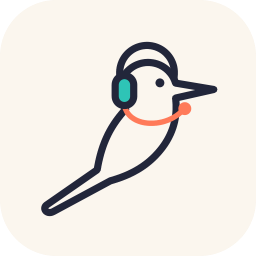

# Peresmeshnik

Real-time translator for calls. You hear the other side in your language — as a voice in your
headphones and as subtitles — and they hear you in theirs, spoken in **your own cloned voice** (on any computer in
English, French, German, Spanish, Portuguese, Italian and Russian, in 13 languages on an NVIDIA GPU; elsewhere in a stock
voice or the cloud's). Works with any call app (Google Meet, Zoom, Telegram, …) through system
audio devices.

**Status: in development.** Version 0.3.0 adds languages: any pair of 14. macOS and Windows have builds; on Linux it
runs from source. Not yet tried in a real call (see below).

- 14 languages, any pair both ways: English, Russian, Ukrainian, German, French, Spanish, Italian, Portuguese, Polish,
  Turkish, Chinese, Japanese, Korean, Arabic — on this computer where there are models for it, else in the cloud
  ([Languages](#languages)).
- macOS, Windows and Linux. Local models (CPU, Apple Silicon, optional NVIDIA GPU) or cloud
  (Gemini Live), switchable in settings.
- Voice cloning of **your own voice only**: a recording (or an imported file) speaks for you once you read two random
  phrases at the microphone and the app hears those words in the voice of every part of the recording; after three
  failed tries it waits a while. This stops a downloaded recording of someone else from speaking for you in a few
  clicks; it cannot stop someone who edits the app's files. A voice recorded in 0.3.0 is confirmed once the same way.
  Tray → **Voices…** lists and deletes the voices. Cloned from a 30–60 s recording. On any computer, a Mac too: Kyutai's
  Pocket TTS on the CPU in English, French, German, Spanish, Portuguese, Italian (its weights need your Hugging Face
  token (type Read), of an account that accepted Kyutai's conditions on huggingface.co/kyutai/pocket-tts: paste it in
  the wizard's Components or "Your voice" page or in Voices…; saved empty, it is forgotten) and Russian. On an NVIDIA
  GPU with 6 GB or more (Windows, Linux; on Windows also a recent driver, see below) XTTS-v2 in 13 languages. Elsewhere
  a stock voice or the cloud speaks for you.
- A hotkey switches between translation and your live voice.

**The cloud is Google's, with your own key.** A direction set to the cloud sends its sound to Google Gemini Live: the
other person's voice for "them → me", yours for "me → them". It needs your own Gemini API key (aistudio.google.com →
Get API key). On the free tier Google may use that audio to improve its models; a paid key is billed by Google, about
$2.2 an hour per direction ([ARCHITECTURE §9](docs/ARCHITECTURE.md#9-hardware-tiers)). Without an NVIDIA GPU the wizard
suggests the cloud for what you say; a direction whose languages have local models (the table below) can stay on
this computer instead (a stock voice then speaks for you). With both directions here no key is needed and nothing is
sent.

Design and numbers: [architecture](docs/ARCHITECTURE.md), [benchmarks](docs/BENCH.md),
[plan](docs/PLAN.md), [models and licenses](docs/MODELS.md).

## Languages

Choose "I speak" and "They speak" in the setup wizard, or later in the tray menu **Languages** (no restart: the new
pair's models are downloaded first while translation goes on, then both directions start again in it; for the seconds
that takes, the call and you hear each other as with translation off). For each
direction the wizard says before anything is downloaded whether it can run on this computer, why not (no speech
recognition, translation or voice for a language), what it downloads and under which licenses; a direction that
cannot run here is translated in the cloud (Gemini Live has all 14 languages). When a new pair from the tray would
move a direction you keep on this computer to the cloud, the app asks first (its sound would go to Google); a later pair
that runs here brings it back. Where your cloned voice does not speak the language here (without an NVIDIA GPU:
Polish, Turkish, Chinese, Japanese, Korean, Arabic), a stock voice speaks instead, and the wizard says so.

**The other person's voice.** "Them → me" speaks in the voice of the person talking, where a cloned voice speaks your
language on this computer (as for your own voice): from their first 3 seconds of clear speech, closer after 5, 10 and 20
s; until then a stock voice, and for the whole call where this computer cannot keep up with it (it says so). Only you
hear it, in your headphones: it never goes into the call (only your own confirmed voice does). What is taken from their
voice, who is speaking (a speaker vector) and the clone made from their clear phrases, stays in this computer's memory
for the call and goes when translation goes off (with Pocket TTS their speech itself is let go once the voice is final,
after 20 s; with the NVIDIA voice pack up to 10 s of it stays until the call ends, for keeping it, and Qwen3-TTS in the
voice pack's runner holds its sample of each person until then too). With them → me on your own server it is that
server's memory instead, and it goes when your computer disconnects (a dropped connection too). It is written to disk
only when you keep it: tray → Keep the voice of the person in this call…, with their agreement, with one person on their
side and after 10 s of their speech. Pocket TTS keeps the clone's state, not a recording; the NVIDIA voice pack saves up
to 10 s of their clearest speech on this computer (phrases where your voice may sound are left out) and makes their
voice from it in your next calls; a server you run yourself on this same computer, as the same user, loads these
recordings into its runner too. Delete it in tray → Voices…. With two people or more on their side, each phrase is said
in the voice of whoever said it, and one not known yet in a stock voice. Off: tray → Their own voice (them → me), or
`their_voice = false` under `[local]` in the settings.

Speech recognition of Turkish, Chinese and Korean on this computer is Whisper on an NVIDIA GPU, through a CUDA build of
onnxruntime: the macOS and Windows apps have none, so there these three are recognized in the cloud. From source on
Linux with an NVIDIA GPU they can run here ([below](#trying-it-from-source-linux)).

<!-- languages:begin (generated: python -m peresmeshnik.languages) -->
| Language | Speech recognition | Stock voice | Your cloned voice | Cloud (Gemini Live) |
|---|---|---|---|---|
| English | parakeet-tdt-0.6b-v3 | piper-en_US-john-medium | qwen3-tts (NVIDIA GPU, voice pack addon) or xtts-v2 (NVIDIA GPU) or pocket-tts-en | ✔ |
| Русский (Russian) | gigaam-v3-e2e-ctc | piper-ru_RU-dmitri-medium | qwen3-tts (NVIDIA GPU, voice pack addon) or xtts-v2 (NVIDIA GPU) or pocket-tts-ru | ✔ |
| Українська (Ukrainian) | parakeet-tdt-0.6b-v3 | piper-uk_UA-ukrainian_tts-medium | — (cloud or a stock voice) | ✔ |
| Deutsch (German) | parakeet-tdt-0.6b-v3 | piper-de_DE-thorsten-medium | qwen3-tts (NVIDIA GPU, voice pack addon) or xtts-v2 (NVIDIA GPU) or pocket-tts-de | ✔ |
| Français (French) | fastconformer-fr-pc | piper-fr_FR-siwis-medium | qwen3-tts (NVIDIA GPU, voice pack addon) or xtts-v2 (NVIDIA GPU) or pocket-tts-fr | ✔ |
| Español (Spanish) | parakeet-tdt-0.6b-v3 | piper-es_MX-ald-medium | qwen3-tts (NVIDIA GPU, voice pack addon) or xtts-v2 (NVIDIA GPU) or pocket-tts-es | ✔ |
| Italiano (Italian) | parakeet-tdt-0.6b-v3 | piper-it_IT-paola-medium | qwen3-tts (NVIDIA GPU, voice pack addon) or xtts-v2 (NVIDIA GPU) or pocket-tts-it | ✔ |
| Português (Portuguese) | parakeet-tdt-0.6b-v3 | piper-pt_BR-faber-medium | qwen3-tts (NVIDIA GPU, voice pack addon) or xtts-v2 (NVIDIA GPU) or pocket-tts-pt | ✔ |
| Polski (Polish) | parakeet-tdt-0.6b-v3 | piper-pl_PL-gosia-medium | xtts-v2 (NVIDIA GPU) | ✔ |
| Türkçe (Turkish) | — (cloud; whisper-large-v3-turbo from source with onnxruntime-gpu on an NVIDIA GPU) | piper-tr_TR-dfki-medium | xtts-v2 (NVIDIA GPU) | ✔ |
| 中文 (Chinese) | — (cloud; whisper-large-v3-turbo from source with onnxruntime-gpu on an NVIDIA GPU) | — (cloud) | qwen3-tts (NVIDIA GPU, voice pack addon) or xtts-v2 (NVIDIA GPU) | ✔ |
| 日本語 (Japanese) | parakeet-tdt_ctc-0.6b-ja | piper-ja_JP-hi_fi_captain-medium | qwen3-tts (NVIDIA GPU, voice pack addon) or xtts-v2 (NVIDIA GPU) | ✔ |
| 한국어 (Korean) | — (cloud; whisper-large-v3-turbo from source with onnxruntime-gpu on an NVIDIA GPU) | piper-ko_KR-kss-medium | qwen3-tts (NVIDIA GPU, voice pack addon) or xtts-v2 (NVIDIA GPU) | ✔ |
| العربية (Arabic) | fastconformer-ar-pcd | — (cloud) | xtts-v2 (NVIDIA GPU) | ✔ |

Translation on this computer: any pair of the 14 (142 of the 182 through English).
<!-- languages:end -->

Subtitles in Chinese, Japanese, Korean and Arabic need a font for that script. macOS and Windows have them; on Linux
install e.g. `fonts-noto-cjk` and `fonts-noto-core` (Debian / Ubuntu) — without one the subtitles show empty boxes,
and the wizard and the tray say so. Arabic is shown right to left.

## Installation on macOS

macOS 14 Sonoma or later on Apple Silicon (M1 and newer).

1. Download `Peresmeshnik-<version>-macos-arm64.dmg` from
   [Releases](https://github.com/a1lezakty/peresmeshnik/releases) (its SHA-256 is in the release notes),
   open it and drag Peresmeshnik to Applications.
2. The app is not signed by Apple (ad-hoc signature only), so macOS blocks its first start ("Apple could not
   verify…"). Click Done, then System Settings → Privacy & Security → "Open Anyway" next to Peresmeshnik, and
   confirm (on macOS 14 right-click the app → Open also works). The same from the Terminal:
   `xattr -dr com.apple.quarantine /Applications/Peresmeshnik.app`.
3. Install [BlackHole 2ch](https://existential.audio/blackhole/) (`brew install --cask blackhole-2ch`, or
   its pkg): the virtual microphone that the other side hears. In your call app choose
   **BlackHole 2ch** as the microphone. On macOS older than 14.4 also BlackHole 16ch (`blackhole-16ch`) as
   the call app's speaker: the app takes the call's sound from there.
4. Start Peresmeshnik: its icon is in the menu bar (no Dock icon). The installer puts only the app on the computer;
   the wizard's **Components** page lists what to download (0.6–2.8 GB for a pair, typically 1.2–1.9 GB), ticked
   where it suits this computer and the pair, with each one's size and license; nothing downloads before Download.
   A direction in the cloud needs your Gemini key ([above](#peresmeshnik)).
5. macOS asks once for two permissions, both in System Settings → Privacy & Security: **Microphone**
   (what you say is translated) and, when translation is first turned on, **Screen & System Audio Recording →
   System Audio Recording Only** (the call app's sound is recorded while translation is on and muted for you,
   so you hear only the translation). Use headphones: through speakers the microphone hears the translation.
   FaceTime cannot be translated this way: its sound is played by a macOS system process, not by FaceTime.
   The app is signed ad hoc, so after an update to a new version macOS asks for both permissions again.

The call hears a hum or an old tone while nothing plays: a program that played into BlackHole was killed hard
(Force Quit, a crash), and the BlackHole driver may keep repeating its last sound buffer. That is the driver's known
behaviour; restarting the sound system clears it: `sudo killall coreaudiod` in the Terminal (or restart the Mac).
Peresmeshnik's own audio helpers close their streams themselves when the app goes, even after a Force Quit.
The call app stays silent after its sound helper `peresmeshnik-tap` was killed (Force Quit, a crash): macOS may keep
the app muted as it was while translated, and Peresmeshnik says so. Restart the call app, or run
`sudo killall coreaudiod` (then the call app's sound comes back without restarting it).

The hotkey ⇧⌘Space switches between translation and your live voice (Settings to change it; a combo
that is a macOS shortcut or another app's global hotkey is refused with the reason; a shortcut inside
another app's own menus is not detected and the hotkey takes it over everywhere).

Removing it: quit it from its menu, drag Peresmeshnik from Applications to the Bin, then delete two folders it
leaves: `~/Library/Application Support/Peresmeshnik` (settings with your Gemini key, your voices, logs, crash
reports) and `~/Library/Caches/Peresmeshnik` (the models). The two permissions go with
`tccutil reset All io.github.a1lezakty.peresmeshnik`. The key alone: Settings… → Forget the key → Save (a key in
`GEMINI_API_KEY` stays: unset it there).

Checked so far only on GitHub's `macos-15` runners (a virtual M1 without GPU, without a real call or real
headphones): the app starts from the .dmg, its menu-bar icon, overlay and hotkey work there, it idles at
~0 CPU and translates a recording with the bundled engines. A live check on a real Mac comes before the
release is published.

## Installation on Windows

Windows 10 version 2004 or later, or Windows 11 (x64).

1. Download `Peresmeshnik-<version>-windows-x64-setup.exe` from
   [Releases](https://github.com/a1lezakty/peresmeshnik/releases) (its SHA-256 is in the release notes) and run
   it. It installs for your user only, without administrator rights, into `%LOCALAPPDATA%\Programs\Peresmeshnik`,
   with a Start menu shortcut; starting at sign-in is a checkbox, off unless you tick it. The `.zip` of the same
   release is the same folder without an installer: unpack it anywhere and run `Peresmeshnik.exe`.
2. The app is not code-signed, so SmartScreen stops the first start of the installer ("Windows protected your
   PC"): click **More info → Run anyway**. Some antivirus programs distrust unsigned programs too.
3. Install [VB-Audio Virtual Cable](https://vb-audio.com/Cable/) yourself (unpack it, run its setup as
   administrator, restart Windows): the virtual microphone that the other side hears. In your call app choose
   **CABLE Output** as the microphone.
4. Start Peresmeshnik from the Start menu: its icon is in the notification area (Windows may put it behind the
   ^ arrow at first; drag it out to keep it in view). The installer puts only the app on the computer; the
   wizard's **Components** page lists what to download (0.6–2.8 GB for a pair, typically 1.2–1.9 GB), ticked where it
   suits this computer and the pair, with each one's size and license; nothing downloads before Download. A direction in the
   cloud needs your Gemini key ([above](#peresmeshnik)). Use headphones: through speakers the microphone hears the
   translation.
5. While translation is on, the app records the call app's own sound and turns it almost all the way down on your
   speakers (you hear the translation instead), and gives it back when translation is off. If the call app closes
   first, or its headset is off, it gets its volume back the next time it plays there, also after you quit
   Peresmeshnik (a small helper, `peresmeshnik-loopback.exe`, waits for that and then ends; the tray says which app).
   A sign-out or an update of Peresmeshnik ends that helper: start Peresmeshnik once. After a removal (a silent one
   does not say which app it was), raise the app in the Windows Volume mixer. Telegram, Zoom, Discord and the like are found
   by themselves; otherwise choose the app in the tray menu **Call app** while the call plays. A browser (Meet) is
   taken with all of its sound, other tabs too.
6. Without an NVIDIA GPU, what you say is spoken to the other side by the cloud (Gemini) or, on this computer, by a
   stock voice. Your own cloned voice needs an NVIDIA GPU with 6 GB or more; it adds the clone model (1.9 GB, up to
   4.7 GB with the pair's models) and the voice pack the wizard installs (3.7 GB to download, 8.2 GB on disk). With a
   card of 8 GB, the pack's addon **Qwen3 + Chatterbox** (tray → Components…, only when you tick it: 75 MB of packages
   into the same pack, 170 MB on disk, and its two models, 5.7 GB) speaks English, Russian, German, French, Spanish,
   Italian, Portuguese, Chinese, Japanese and Korean with Qwen3-TTS (the first sound in ~0.1 s), Chatterbox
   Multilingual saying again a clause Qwen3 does not stop on; Polish, Turkish and Arabic stay with XTTS-v2. Without the
   addon, or on a 6 GB card, XTTS-v2 speaks them all. With both directions cloned on one card, the other person's voice
   takes what is left beside yours, counting a runner process for each (~0.5 GB of CUDA context) and ~0.6 GB for the
   desktop: on 8 GB yours is Qwen3-TTS (with Chatterbox up to ~5.9 GB) and theirs Pocket TTS on the CPU (or a stock
   voice, said why); on 12 GB theirs is XTTS-v2 (~2 GB); on 16 GB both are Qwen3-TTS; on 6 GB both are XTTS-v2.

The hotkey Ctrl+Alt+Space switches between translation and your live voice (Settings to change it; a combo that
Windows keeps for itself, such as Alt+Tab or Win+Space, or that another app has taken is refused with the reason).
The uninstaller (Settings → Apps → Peresmeshnik, or `unins000.exe` in its folder) closes the app and removes its files.
It asks whether to remove the voice pack and its downloads (up to about 12 GB), your saved voices, and your settings
with your Gemini key ("No" by default for each); logs and the models stay in `%LOCALAPPDATA%\Peresmeshnik` (the models
in its `Cache` folder) until you delete that folder. A silent uninstall (`/VERYSILENT`) asks nothing and keeps it all.
The key alone: Settings… → Forget the key → Save (a key in `GEMINI_API_KEY` stays: unset it there).

Checked so far only on GitHub's `windows-latest` runners (Windows Server 2025 in a VM, without a GPU, real sound
devices or a real call): the installer runs silently, the installed app starts, its tray icon, overlay and hotkey
work there, it idles at ~0 CPU, closes cleanly when asked, and the frozen app translates a recording with the
bundled engines. SmartScreen on a fresh PC, VB-Cable, a real call and the NVIDIA voice pack on Windows are
checked by hand before the release is published.

### Trying it from source (Linux)

Not ready for calls yet. With PipeWire and Python 3.11+: `uv run peresmeshnik app`. Qt needs
`libxcb-cursor0` (`sudo apt install libxcb-cursor0` on Debian / Ubuntu); on Wayland the app runs
through XWayland so that its subtitles stay on top. While translation is on, the app moves the call
app's sound to "Peresmeshnik Call" and gives it back when it is off: Telegram, Zoom, Discord and the like
are found by themselves, otherwise choose the app in the tray menu "Call app" while the call plays. A
browser (Meet) moves with all of its sound, other tabs too. One instance runs per user:
while yours is open, the app instances that the tests start exit with code 3 ("already running").
Your cloned voice runs in a venv of its own (PyTorch and coqui-tts, ~7 GB with CUDA): `uv venv -p 3.12 ~/.local/share/Peresmeshnik/clone-venv`,
`uv pip install -p ~/.local/share/Peresmeshnik/clone-venv/bin/python --require-hashes -r voice-runner/requirements-linux-cuda.txt --build-constraints voice-runner/requirements-linux-cuda.txt`
(every package pinned and checked by its SHA-256, and so is the setuptools that builds the two packages that come as source,
docopt and unidic-lite; with CPU-only PyTorch: `requirements-linux.txt` in both places and `--index-strategy unsafe-best-match`), then start the
app with `PERESMESHNIK_VOICE_CMD="$HOME/.local/share/Peresmeshnik/clone-venv/bin/python voice-runner/voice_runner.py"`.
The voice pack's addon Qwen3 + Chatterbox (an NVIDIA GPU with 8 GB) goes into the same venv:
`uv pip install -p ~/.local/share/Peresmeshnik/clone-venv/bin/python --no-deps --require-hashes -r voice-runner/requirements-linux-addon-cuda.txt --build-constraints voice-runner/requirements-linux-addon-cuda.txt`
(the whole venv pinned, `--no-deps` because chatterbox-tts asks for torch 2.6 and the pack has 2.8; CPU-only:
`requirements-linux-addon.txt` and `--index-strategy unsafe-best-match`), then start the app with
`PERESMESHNIK_VOICE_ADDON=1` too: only then is Qwen3-TTS chosen.
Turkish, Chinese and Korean speech recognition on an NVIDIA GPU (Whisper, 1.6 GB more) needs onnxruntime with CUDA in
the app's own environment, in place of the CPU one (CUDA 12 and cuDNN 9 installed): `uv pip uninstall onnxruntime`,
`uv pip install onnxruntime-gpu==1.31.1`, then start with `uv run --no-sync peresmeshnik app` (a plain `uv run` puts
the CPU one back). These steps are not checked by the project; its benchmarks ran Whisper with onnxruntime-gpu
1.31.1.
What stays when you stop using it: `~/.config/Peresmeshnik` (settings with your Gemini key),
`~/.local/share/Peresmeshnik` (your voices, logs, crash reports, the clone's venv if you made it there) and
`~/.cache/Peresmeshnik` (the models).

**Models of other pairs** stay on disk until you remove them: tray → **Components…** lists everything downloaded
with its size on disk and a Remove button (the voice pack too), and what you can still download. They are in the
`models` folder of the cache folder above (macOS `~/Library/Caches/Peresmeshnik/models`, Windows
`%LOCALAPPDATA%\Peresmeshnik\Cache\models`, Linux `~/.cache/Peresmeshnik/models`), one folder per model; choosing a pair
again downloads its models again.

## Your own server: a weak laptop, a strong computer

The translation (speech recognition, translation, the voice and your cloned voice) can run on another computer of yours
or on a rented NVIDIA server, while the laptop only records and plays: it needs no models and little CPU. On the strong
computer, from source as above (Linux or Windows, Python 3.11+, `uv`):

    uv run peresmeshnik serve --fetch en-ru     # the first time: the models of your pair, after their licenses
    uv run peresmeshnik serve

Its first start (and a start with `--code` later) prints a line like `https://192.168.1.20:47000/#K7QM-2XPA-4DFE` and the
certificate's fingerprint. On the laptop: tray → **Server…** → paste that line: the two computers prove to each other
that they know the code (one use, 10 minutes), the laptop keeps the server's certificate and a token of its own. Then
choose the server for *Them → me* and *Me → them* in Settings; when it is down or too slow, a side goes local if the
laptop has its models, else the original is heard meanwhile (the call app's sound for you, your own voice for the call),
and the tray says so. `serve --list` shows the paired laptops, `serve --revoke NAME` unpairs one; for a new code stop the
server and start it with `--code`. One laptop at a time; its sides stay warm on the server for 10 minutes after it
leaves (`[server] warm_s`), so a reconnect does not load the models again.

- **Where it listens.** Only on this computer's private addresses (home network, Tailscale) and 127.0.0.1. `--public`
  only *allows* a public `--host`, it does not pick one: `--host 0.0.0.0 --public` listens on every address. `--host`
  takes an IP address, not a name. Give the server a fixed address in your router (a DHCP reservation), or the line you
  paired with stops working when it changes; allow the port in the server's own firewall (ufw, firewalld; on Windows the
  network must be "Private", not "Public").
- **Through the internet, or a rented server:** Tailscale on both computers, or an ssh tunnel with a terminal,
  `ssh -tt -L 47000:127.0.0.1:47000 <server> sleep infinity`, and pair with `https://127.0.0.1:47000/#<code>` (`ssh -N`
  delays small messages; the network adds one round trip to the voice either way, BENCH "Remote"). Keep port 47000
  closed in the provider's firewall: a cloud VM's "private" address is often reachable from the internet through its
  provider's 1:1 NAT, and Docker's `-p 47000:47000` (without `127.0.0.1:`) opens the port to everyone.
- **A rented NVIDIA server:** `packaging/server/Dockerfile` (build it yourself: no image is published, it would ship
  the models' and Piper's licenses with it). Your cloned voice runs on its GPU. Run it as the file's head shows: the
  port on 127.0.0.1 only, `--stop-timeout 60`, and the voices in memory (`--tmpfs`); its pairing line names the
  container's own address, pair with the `127.0.0.1` one through the ssh tunnel.
- **Pairing.** While a code is open (10 minutes, or until it is used), anyone on the same network can burn it with five
  wrong tries: then start the server again with `--code`. A paired laptop is trusted: the server checks that a voice
  for *Me → them* is marked as your own confirmed voice, which stops an honest laptop's mistake, not a paired laptop
  that lies (`serve --revoke` it).
- **What goes there:** the call's sound and your microphone while a side is on the server, and your own voice
  profile for the session, only once it is confirmed as yours at the microphone and only when the server speaks with
  it (no NVIDIA GPU there: a stock voice, nothing is sent; any other voice sent for *Me → them*: a stock voice). It is
  kept in a folder only the server's user can read while the laptop's session is warm, up to 10 minutes after it
  leaves (`[server] warm_s`, 0: at once), and deleted then, first thing when the server stops, or at its next start
  after a crash. The server's log keeps times only, no words (`--log` for debugging). Your Gemini key never goes there.
  The provider of a rented server can technically see its memory and disk.
- **For yourself only:** a server for your own laptops is fine; running it as a service for others is not (the voice
  models' licenses are non-commercial).

## When something goes wrong

- **The cloud fails.** A side set to the cloud (Gemini) goes local by itself when the connection drops, Google answers
  with an error or the quota is used up, or no translated voice comes `cloud.fallback_after_s` (6 s) after a phrase
  began. What the cloud had not said yet is said by the local voice, what it had said is not repeated; the tray says
  so once. Later, when someone starts a phrase, the app tries the cloud again (after 30 s, then less and less often, at
  most every 15 min while it stays down: nothing runs on a timer) and goes back to it at the next phrase. Going local
  needs that direction's speech recognition, translation and stock voice on this computer: the wizard downloads them
  for a cloud direction too, unless its subtitles come from the cloud ("Subtitles from the cloud") or its languages
  have no local models; a noncommercial stock voice (Turkish, Korean, Japanese) only if you accept its license. Your
  cloned voice takes over where it is ready, else the stock voice. Without a local path the wizard says so beforehand,
  the tray says what is missing, and meanwhile you hear the call as it is and the call hears your own live voice (your
  choice over silence; the hotkey changes nothing until the translation is back).
- **Your own server fails** (a direction set to `remote`: tray menu, Server…). The same: this computer translates when
  it has the models, else the call passes as it is, and the server is tried again (after 5 s, at most every 150 s). A
  refused device (revoked with `peresmeshnik serve --revoke`, or the server's certificate changed) is not tried again:
  pair again. Paired this computer again? Revoke its old entry on the server: `laptop` stays next to `laptop (2)`
  (`peresmeshnik serve --list`, `--revoke`). The pairing code and the device token protect the server, not the network: a private address (a home LAN,
  Tailscale, or 100.64/10 that some mobile operators give many customers) is not a trusted network by itself.
- **A crash.** A report goes to the `reports` folder in the app's data folder (macOS `~/Library/Application
  Support/Peresmeshnik`, Windows `%LOCALAPPDATA%\Peresmeshnik`, Linux `~/.local/share/Peresmeshnik`), and the tray menu
  shows **Crash report…**: read it, copy it, or open a GitHub issue with it and send it yourself — the app sends
  nothing. A report has the app's version, the OS, CPU, RAM, GPU, the engines and models of the settings, where it
  failed and the last lines of the log. It has no subtitles or translations, no audio, no names of devices, of the
  call app or of the voices, no key and not your user name. When the Piper voice helper dies, only it starts again and
  the voice goes on a few seconds later; a side whose translation dies otherwise starts again by itself (its models
  load again: up to ~20 s); after 4 failures within a minute it stays off and says why. One tray message each time.
- **Latency.** Tray → **Show latency**: each subtitle ends with its clause's times from the end of the speech to the
  subtitle and to the voice (a cloud phrase: to the end of its voice). Off by default.

## License

[PolyForm Noncommercial 1.0.0](LICENSE): anyone may use, change and share it for any
noncommercial purpose; selling it or using it commercially is not allowed. Models downloaded by
the app have their own licenses, listed in [docs/MODELS.md](docs/MODELS.md).

Required Notice: Copyright (c) 2026 Akty (https://github.com/a1lezakty)

The macOS and Windows apps bundle a Piper TTS runner ([`piper-runner/`](piper-runner/), GPL-3.0, with
[piper-tts](https://github.com/OHF-Voice/piper1-gpl) and espeak-ng): a separate program the app talks
to over a pipe. Its license and those of the other bundled packages are in
`Peresmeshnik.app/Contents/Resources/licenses/` and in the `licenses` folder of the Windows install.

The Windows voice pack (your own voice on an NVIDIA GPU, downloaded by the wizard after you accept its licenses) is a
Python of its own with PyTorch (BSD-3-Clause; most of its 3.7 GB are the NVIDIA CUDA and cuDNN libraries inside it,
under [NVIDIA's license terms](https://docs.nvidia.com/cuda/eula/)) and coqui-tts (MPL-2.0), with the text tools for
Chinese and Japanese (pypinyin, cutlet with jaconv and mojimoji, fugashi with MeCab, the UniDic dictionary: MIT,
Apache-2.0, BSD-3-Clause; [docs/MODELS.md](docs/MODELS.md)); the XTTS-v2 model it runs is under the
[Coqui Public Model License](https://huggingface.co/coqui/XTTS-v2/blob/main/LICENSE.txt) (noncommercial only). It needs
an NVIDIA GPU with 6 GB of memory or more, compute capability 6.1 or newer (GeForce GTX 10xx and later; a GTX 10xx is
not measured: the app measures the clone at start and uses the stock voice if the card is slower than real time) and
driver 570.65 or newer (528.33 to 570.64: not checked, may work); the wizard checks before the download.
Its addon Qwen3 + Chatterbox (Components…, only when ticked; a card of 8 GB) adds to the pack, with what they pull in
(checked in the packages' own metadata and license files, 2026-11-11): faster-qwen3-tts, chatterbox-tts,
resemble-perth, pyloudnorm, conformer, onnxruntime, zipp, setuptools 69.5.1 (MIT); qwen-tts-hf, transformers 5.16.1,
huggingface-hub 1.33.0, accelerate, diffusers, s3tokenizer, onnx, flatbuffers, ml-dtypes (its Eigen headers MPL-2.0),
importlib-metadata, lazy-importer (Apache-2.0); sox, omegaconf, httpx, httpcore (BSD-3-Clause) — no GPL, AGPL or LGPL
([docs/MODELS.md](docs/MODELS.md)); not pykakasi (GPL-3.0: Chatterbox's Japanese romanization) or gradio. The models
are Qwen3-TTS 0.6B Base (Apache-2.0) and Chatterbox Multilingual (MIT; every sound it makes carries Resemble AI's
inaudible Perth watermark).

---

**По-русски.** Пересмешник — переводчик звонков в реальном времени. Собеседника вы слышите
на своём языке — голосом в наушниках и субтитрами, а он вас — на своём, вашим же клонированным
голосом (с видеокартой NVIDIA; без неё — стоковым голосом или голосом облака). Облако — Google Gemini с вашим ключом:
звук стороны в облаке уходит в Google. Работает с любой программой созвона через системные аудиоустройства; macOS, Windows и
Linux, локальные модели или облако; 14 языков в любой паре (0.3.0). Сейчас в разработке; сборки для macOS и Windows
— установка выше.
Лицензия некоммерческая: пользоваться можно всем, продавать нельзя.
